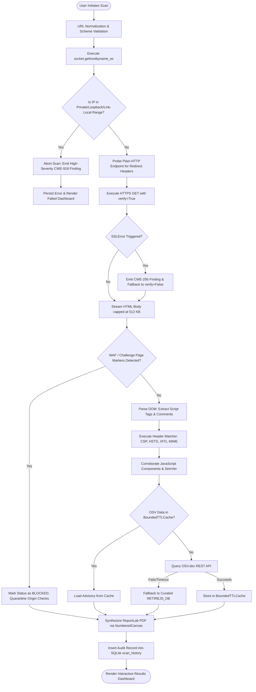

# FRONTGUARD: AUTOMATED PASSIVE WEB SECURITY VULNERABILITY SCANNER
# Exhaustive Academic Project Technical Dossier & Report Knowledge Base

**Degree:** Master of Computer Applications (MCA)  
**Project Title:** FRONTGUARD: Automated Passive Web Security Vulnerability Scanner  
**Target Document Scope:** Comprehensive Technical Knowledge Base for 60–80 Page Academic Project Report  
**Subject Area:** Web Application Security / Software Engineering / Python Systems Programming  
**Document Version:** 2.0 (Deep Academic Edition)  

---

## TABLE OF CONTENTS

1. [CHAPTER 1: INTRODUCTION](#chapter-1-introduction)
   - 1.1 Project Overview & Context
   - 1.2 The Problem Domain & Threat Landscape
   - 1.3 Limitations of Conventional Security Scanners
   - 1.4 The FrontGuard Passive Paradigm
   - 1.5 Scope of the Project
2. [CHAPTER 2: PROJECT OBJECTIVES](#chapter-2-project-objectives)
   - 2.1 Primary Engineering Objectives
   - 2.2 Measurable & Quantitative Targets
   - 2.3 Operational & Defensive Benchmarks
3. [CHAPTER 3: SYSTEM ANALYSIS](#chapter-3-system-analysis)
   - 3.1 Identification of Need
   - 3.2 Preliminary Investigation & Literature Review
   - 3.3 Feasibility Study (Technical, Operational, Economic)
   - 3.4 Project Planning & Work Breakdown Structure (WBS)
   - 3.5 Project Scheduling (Gantt Chart & PERT Critical Path Analysis)
   - 3.6 Software Requirement Specification (SRS)
     - 3.6.1 Functional Requirements (FR-01 to FR-15)
     - 3.6.2 Non-Functional Requirements (NFR-01 to NFR-10)
   - 3.7 System Specifications (Hardware & Software)
   - 3.8 Detailed System Data Models
     - 3.8.1 Object-Oriented Class Model
     - 3.8.2 Activity Model & Process Logic
     - 3.8.3 Chronological Sequence Model
     - 3.8.4 Entity-Relationship Model & 3NF Schema Analysis
     - 3.8.5 Use Case Behavioral Model
4. [CHAPTER 4: SYSTEM DESIGN & ARCHITECTURE](#chapter-4-system-design--architecture)
   - 4.1 Architectural Pattern & Decomposition
   - 4.2 Comprehensive Modularization Specifications (7 Core Modules)
   - 4.3 Data Integrity, Concurrency & Security Constraints
5. [CHAPTER 5: TESTING & QUALITY ASSURANCE](#chapter-5-testing--quality-assurance)
   - 5.1 Quality Assurance Strategy & Test Harness
   - 5.2 Exhaustive Test Suite Matrix (20+ Representative Scenarios)
   - 5.3 Regression & Code Coverage Metrics
6. [CHAPTER 6: SYSTEM SECURITY & DEFENSE-IN-DEPTH](#chapter-6-system-security--defense-in-depth)
   - 6.1 Scanner Threat Modeling
   - 6.2 Pre-Flight SSRF Protection Architecture
   - 6.3 Anti-DoS & Streaming Memory Bounds
   - 6.4 Monotonic Wall-Clock Scan Budget Enforcement
   - 6.5 WAF & Bot Challenge Detection Engine
   - 6.6 Thread-Safe LRU-TTL Cache Management
7. [CHAPTER 7: COST ESTIMATION & ECONOMIC ANALYSIS](#chapter-7-cost-estimation--economic-analysis)
   - 7.1 Software Engineering Effort Valuation (COCOMO II Model)
   - 7.2 Total Cost of Ownership (TCO) vs. Commercial Alternatives
8. [CHAPTER 8: REPORTING & TELEMETRY ARCHITECTURE](#chapter-8-reporting--telemetry-architecture)
   - 8.1 Web Presentation & UI Design System
   - 8.2 Typographic Two-Pass ReportLab PDF Engine
9. [CHAPTER 9: FUTURE SCOPE & RESEARCH ROADMAP](#chapter-9-future-scope--research-roadmap)
   - 9.1 Headless Browser & Client-Side SPA Execution
   - 9.2 Authenticated State & Contextual Ingress
   - 9.3 CI/CD DevSecOps Automation
   - 9.4 Passive Subdomain Discovery & CT Monitoring
   - 9.5 Enterprise SIEM Integration
10. [CHAPTER 10: APPENDICES](#chapter-10-appendices)
    - 10.1 Core Python Implementation Code Listings
    - 10.2 Academic & Industry Bibliography

---

## CHAPTER 1: INTRODUCTION

### 1.1 Project Overview & Context
Over the past decade, the architectural paradigm of the World Wide Web has shifted dramatically from monolithic server-side rendered applications to highly distributed, decoupled architectures. Modern web platforms rely heavily on client-side single-page applications (SPAs), extensive microservice meshes, third-party Content Delivery Networks (CDNs), and complex multi-layered reverse proxies. While this evolution has unlocked unprecedented scalability and rich user experiences, it has simultaneously introduced subtle, pervasive security vulnerabilities at the application perimeter.

Front-end components, HTTP transmission headers, and client-side JavaScript runtimes are now primary vectors for adversarial exploitation. Misconfigurations in HTTP headers can completely negate transport layer encryption, enable cross-site scripting (XSS), expose sensitive web applications to clickjacking, and permit browser-level data exfiltration. Simultaneously, web developers routinely include dozens of external client-side JavaScript packages—such as jQuery, Bootstrap, Lodash, Moment.js, Vue, and Axios—without adequate dependency tracking. When these third-party libraries harbor published Common Vulnerabilities and Exposures (CVEs), the host application becomes vulnerable to severe exploits including remote code execution, client-side prototype pollution, and DOM-based Cross-Site Scripting.

**FRONTGUARD** is an automated, passive web application security vulnerability scanner engineered in Python, Flask, SQLite, and ReportLab. It is explicitly architected to inspect, analyze, corroborate, and report on perimeter security weaknesses without issuing a single destructive or invasive payload.

### 1.2 The Problem Domain & Threat Landscape
To understand the imperative for FrontGuard, the vulnerabilities it discovers must be analyzed through the lens of established cybersecurity taxonomies, specifically the **OWASP Top 10:2021** and the **MITRE Common Weakness Enumeration (CWE)**:

#### 1. OWASP A05:2021 – Security Misconfiguration
Security misconfiguration is among the most widespread application weaknesses on the contemporary web. It manifests when security headers are absent, incompletely defined, or syntactically invalid:
- **CWE-693 (Protection Mechanism Failure):** When headers such as `Content-Security-Policy` (CSP) or `X-Content-Type-Options` are omitted, modern browser defense mechanisms are entirely disabled. Browsers default to permissive execution models, allowing injected script tags or MIME-type confusion attacks (where an image or text file containing script content is executed as JavaScript).
- **CWE-319 (Cleartext Transmission of Sensitive Information):** Without `Strict-Transport-Security` (HSTS), web traffic is vulnerable to SSL-stripping and man-in-the-middle (MitM) downgrade attacks on initial visits.
- **CWE-1021 (Improper Restriction of Rendered UI Layers):** Without `X-Frame-Options` or CSP `frame-ancestors`, malicious third parties can embed the legitimate application inside transparent `<iframe>` layers to execute clickjacking attacks, intercepting user interactions and credentials.

#### 2. OWASP A06:2021 – Vulnerable and Outdated Components
Modern web applications rarely build all functionality from scratch; the average commercial website imports between 10 and 50 third-party JavaScript dependencies:
- Outdated versions of jQuery (`<3.4.0`) contain critical Prototype Pollution vulnerabilities (`CVE-2019-11358`) and Cross-Site Scripting via `location.hash` selectors (`CVE-2012-6708`, `CVE-2015-9251`).
- Legacy versions of Lodash (`<4.17.12`) suffer from unauthenticated prototype pollution in functions such as `_.defaultsDeep()` and `_.merge()` (`CVE-2019-10744`).
- Outdated versions of Bootstrap (`<3.4.1`) allow persistent XSS via `data-target` and tooltip attributes (`CVE-2018-14040`, `CVE-2019-8331`).
Developers frequently update server-side language runtimes while completely neglecting the client-side JavaScript bundles deployed to end-user browsers.

#### 3. CWE-798 (Use of Hard-coded Credentials) & DOM XSS Sinks
During rapid agile development, engineers frequently embed sensitive administrative credentials—such as staging API keys, Firebase configuration tokens, AWS Access Key IDs, and bearer authentication tokens—directly into inline `<script>` tags or HTML comments. Furthermore, client scripts frequently execute dangerous dynamic JavaScript sinks such as `eval()`, `document.write()`, and unvalidated `.innerHTML` assignments, providing immediate injection points for DOM-based Cross-Site Scripting.

### 1.3 Limitations of Conventional Security Scanners
Dynamic Application Security Testing (DAST) tools and active vulnerability scanners (such as OWASP ZAP, Burp Suite Professional, Acunetix, and Nessus) are the standard tools of commercial penetration testing. However, in routine operations, continuous integration pipelines, and academic or sensitive production environments, they exhibit fundamental operational liabilities:
1. **Intrusive Overhead and Service Disruption:** Active scanners function by firing thousands of fuzzing strings, SQL injection vectors, and malformed parameter payloads. In production environments, this can corrupt production databases, trigger account lockouts, exhaust database connection pools, and induce catastrophic denial of service.
2. **False Sense of Security from Surface-Level Auditing:** Existing tools that claim to audit HTTP response headers usually execute primitive key-existence checks:
   $$\text{Header Present} \implies \text{Status: PASS}$$
   This methodology fails catastrophically in real-world scenarios. A site deploying `Content-Security-Policy: default-src * 'unsafe-inline'` or `Strict-Transport-Security: max-age=0` is marked as "Secure" by naive scanners, despite the policy actively disabling browser protection.
3. **Prohibitive Cost and Operational Complexity:** Enterprise security scanners cost tens of thousands of dollars in annual licensing fees, demand substantial multi-gigabyte compute instances, and require specialized security engineers to configure target scopes and authentication credentials.
4. **Air-Gapped and Network Isolation Failures:** Most component scanners depend on continuous, high-bandwidth communication with centralized SaaS platforms. In secure intranet zones, air-gapped laboratory networks, or offline auditing environments, conventional scanners fail to operate.

### 1.4 The FrontGuard Passive Paradigm
FrontGuard establishes a zero-impact, deterministic security auditing methodology:
- **Strictly Passive Execution:** All network communication is strictly read-only. FrontGuard issues ordinary HTTP/HTTPS GET requests matching modern browser signatures. It never submits form mutations, injects SQL payloads, or fuzzes URL parameters.
- **Syntactic Tokenization vs. Existence Checks:** FrontGuard implements directive-level parsing. It decomposes complex multi-statement headers (like CSP) into individual directives and source expressions, evaluating each token against modern browser specification rules.
- **Corroborated Multi-Signal SCA:** Component discovery does not rely on a single fragile indicator. FrontGuard analyzes URL path structures, script header comment banners, query parameters (`?ver=`), and in-content global namespace variables, weighting each signal to produce High, Medium, or Low confidence ratings.
- **Autonomous Hybrid Intelligence:** FrontGuard communicates with Google’s Open Source Vulnerabilities (OSV.dev) API and the official Retire.js knowledge base in real time, yet maintains a curated, fully offline database (`RETIREJS_DB`) to guarantee 100% functionality in air-gapped environments.

### 1.5 Scope of the Project
- **In Scope:**
  - Passive interrogation of remote web endpoints via public FQDNs or IP addresses.
  - Pre-flight DNS resolution and defensive Server-Side Request Forgery (SSRF) validation.
  - Complete structural validation of 12+ HTTP security response headers.
  - Detection and semantic version evaluation of 15+ major client-side JavaScript frameworks.
  - Regex identification of hardcoded API keys, passwords, private keys, and DOM XSS sinks.
  - Generation of interactive web dashboards and two-pass, publication-ready PDF audit reports.
  - Relational persistence of historical scan metadata in SQLite.
- **Out of Scope (By Intentional Design):**
  - Active penetration testing, parameter fuzzing, and exploit delivery.
  - Bypassing authentication barriers, CAPTCHA puzzles, or Proof-of-Work gates.
  - Recursive multi-tier web crawling (FrontGuard evaluates the landing perimeter and its immediate dependencies).

---

## CHAPTER 2: PROJECT OBJECTIVES

### 2.1 Primary Engineering Objectives
1. **Develop a Non-Destructive Vulnerability Extraction Engine:** Construct a multi-threaded, robust network client using Python and Requests capable of safely extracting HTTP response headers, redirect metadata, HTML DOM structures, and external JavaScript scripts.
2. **Implement an AST-Style Header Tokenizer:** Build a deterministic parsing engine in `scanner/matcher.py` that dissects raw header strings into directive-source key-value pairs, validating compliance against W3C, RFC 6797, and RFC 7034 specifications.
3. **Engineer a 4-Part Semantic Version Engine:** Develop a custom version parser and comparator (`SemVer`) capable of evaluating 4-part release strings (e.g., `1.2.3.4`), ordering alphanumeric pre-release identifiers (`1.0.0-rc.2 < 1.0.0-rc.10`), and stripping non-semantic build metadata (`+build2024`).
4. **Establish Real-Time CVE Cross-Referencing:** Integrate an asynchronous client for Google's OSV.dev REST API and Retire.js catalog to correlate discovered libraries with active NIST National Vulnerability Database (NVD) entries and Common Vulnerability Scoring System (CVSS v3.1) metrics.
5. **Architect an Enterprise PDF Synthesis Pipeline:** Develop an automated document synthesis engine using ReportLab that computes two-pass page numbers, formats visual risk scorecards, and provides concrete remediation code snippets.

### 2.2 Measurable & Quantitative Targets
- **Execution Budget:** Enforce an unyielding **45.0-second wall-clock ceiling (`ScanBudget`)** across the entire audit pipeline, terminating hung connections gracefully.
- **Streaming Ingestion Limits:** Enforce a hard **512 KB cap** on HTML body downloads and a **256 KB cap** on external script fetches to neutralize memory exhaustion and decompression bomb attacks.
- **Pre-Flight SSRF Protection:** Guarantee 100% rejection of any target hostname that resolves to IPv4 private address space (RFC 1918), loopback (`127.0.0.0/8`), link-local (`169.254.0.0/16`), or multicast ranges.
- **Automated Verification:** Achieve and maintain a 100% pass rate across **162 automated unit tests** executing in under **1.0 second**.

### 2.3 Operational & Defensive Benchmarks
- **Zero-Configuration Deployment:** The application must start out-of-the-box without requiring complex installation scripts or mandatory environment files, automatically generating high-entropy cryptographic keys in memory if `.env` is omitted.
- **WAF Challenge Resilience:** When encountering Cloudflare Turnstile, AWS WAF, or Akamai challenge pages, FrontGuard must identify the challenge screen and quarantine the scan status as `BLOCKED`, preventing false vulnerability alerts.
- **Air-Gapped Autonomous Operation:** If remote network connectivity fails during scanning, all components must fall back to the built-in offline database without throwing unhandled exceptions.

---

## CHAPTER 3: SYSTEM ANALYSIS

### 3.1 Identification of Need
Modern enterprise IT and educational institutions face severe constraints in vulnerability management:
1. **Lack of Continuous Visibility:** Applications are often tested only once a year during formal security audits. In the interim, developers deploy patches, update libraries, and modify web server configs, frequently dropping critical security headers without realizing it.
2. **The High Cost of Security Auditing:** Small-to-medium enterprises (SMEs) and academic departments cannot afford dedicated enterprise DAST subscriptions ($10,000–$50,000/year).
3. **The Risk of Automated Penetration Testing:** Automated fuzzing tools frequently crash testing environments, trigger account lockouts, and flood logs with thousands of error alerts.

FrontGuard fulfills the need for a **frictionless, cost-free, non-destructive audit engine** that can be run on-demand or embedded into periodic administrative reviews.

### 3.2 Preliminary Investigation & Literature Review

#### Comparative Matrix: FrontGuard vs. Existing Solutions

| Evaluation Feature | FrontGuard | OWASP ZAP (Passive) | Google Lighthouse | cURL / Bash Scripts | Commercial DAST (Burp / Snyk) |
|---|---|---|---|---|---|
| **Intrusiveness** | 100% Passive | Passive mode available | 100% Passive | 100% Passive | Highly Invasive (Active Fuzzing) |
| **Header Parsing Depth** | Directive AST Tokenization | Basic Existence Checks | Basic Best-Practices | None (Manual Inspection) | Variable (Often basic presence) |
| **Client-Side SCA** | Multi-Signal (Regex, Path, Banner) | Limited Add-on required | None | None | Extensive (Agent-based) |
| **Live Advisory Feeds** | OSV.dev + Retire.js + Offline | Offline XML / DB | None | None | Proprietary Threat Intelligence |
| **Runtime Footprint** | `< 50 MB RAM` | `> 1000 MB RAM` (Java) | `> 500 MB RAM` (Node/Chrome)| `< 10 MB RAM` | Heavy Cloud / Enterprise VM |
| **Reporting Output** | Publication-grade PDF + Web | Basic HTML / XML Dump | JSON / Web View | Terminal Raw Text | Enterprise Dashboard / PDF |
| **Licensing Cost** | 100% Free / Open Source | Free / Open Source | Free / Open Source | Free / Open Source | \$3,000 – \$25,000 / Year |

### 3.3 Feasibility Study

#### 3.3.1 Technical Feasibility
The FrontGuard system architecture is constructed using battle-tested, open-source technologies:
- **Python 3.10–3.14:** Provides rapid prototyping, built-in memory safety, native IPv4/IPv6 socket handling, and extensive networking libraries.
- **Flask (v3.0.3):** Minimalist WSGI web framework offering lightweight routing, Jinja2 templating, and clean separation of concerns.
- **Requests & urllib3:** Robust HTTP client supporting streaming responses, certificate verification bypass hooks, custom connection pools, and fine-grained socket timeouts.
- **BeautifulSoup4:** Fault-tolerant HTML parser capable of handling malformed, legacy HTML documents without throwing fatal parsing exceptions.
- **ReportLab (v4.2.2):** High-performance PDF generation engine that builds documents dynamically from algorithmic Flowables, supporting millimeter-level layout precision.
- **OSV.dev REST API:** Distributed vulnerability database compliant with the OpenSSF Open Source Vulnerability schema, guaranteeing high-availability CVE intelligence.

#### 3.3.2 Operational Feasibility
- **Target Audience:** Security analysts, DevOps engineers, academic evaluators, and system administrators.
- **User Interface Design:** Built upon a utilitarian dark-mode palette (`#090a0d` canvas, `#111318` cards, `#232733` borders) that eliminates distracting decorative elements in favor of high-contrast, actionable data density.
- **Zero Learning Curve:** Operating the scanner requires only entering an FQDN and clicking "Initiate Scan". All internal complexity (DNS resolution, SSL fallback, SCA corroboration) is fully autonomous.

#### 3.3.3 Economic Feasibility
- **Direct Capital Expenditure:** \$0.00. No proprietary commercial components, licenses, or database engines are utilized.
- **Operational Expenditure:** Can be hosted indefinitely on free-tier cloud infrastructure (e.g., Oracle Cloud Always Free ARM/x86 instances) or executed locally on commodity laptops with 2 GB RAM.
- **Cost Avoidance:** Displaces expensive commercial vulnerability assessment subscriptions for perimeter monitoring.

### 3.4 Project Planning & Work Breakdown Structure (WBS)
The project execution was organized into 6 chronological development work packages totaling **170 engineering hours**:

```
FRONTGUARD PROJECT (170 Hours)
│
├── 1.0 Architecture & Threat Modeling (22 Hours)
│   ├── 1.1 Scope definition and protocol research (8h)
│   └── 1.2 Threat modeling and passive boundary definitions (14h)
│
├── 2.0 Extractor & Header Parsing Engine (38 Hours)
│   ├── 2.1 Multi-threaded network extractor with stream caps (18h)
│   └── 2.2 CSP, HSTS, and security header AST tokenizer (20h)
│
├── 3.0 Client-Side SCA & SemVer Subsystem (36 Hours)
│   ├── 3.1 Component signature discovery and regex matching (16h)
│   ├── 3.2 4-part SemVer version comparison engine (10h)
│   └── 3.3 OSV.dev and Retire.js live API integration (10h)
│
├── 4.0 Defensive Reliability & Hardening (30 Hours)
│   ├── 4.1 Pre-flight DNS interrogation & SSRF prevention (10h)
│   ├── 4.2 WAF challenge detection and quarantine logic (8h)
│   └── 4.3 Monotonic ScanBudget and BoundedTTLCache (12h)
│
├── 5.0 Persistence, Web Cockpit & PDF Engine (26 Hours)
│   ├── 5.1 SQLite relational schema & migration handler (8h)
│   ├── 5.2 Utilitarian dark-mode web cockpit (8h)
│   └── 5.3 ReportLab two-pass typographic PDF builder (10h)
│
└── 6.0 Testing, Quality Assurance & Audit (18 Hours)
    ├── 6.1 Pytest test suite development (162 unit tests) (12h)
    └── 6.2 Security audit, secret purging & GitHub prep (6h)
```

### 3.5 Project Scheduling

#### 3.5.1 Gantt Chart Milestone Schedule
The 14-week execution timeline is structured as follows:

| Milestone ID | Task / Work Package Name | Start Week | End Week | Duration | Predecessors |
|---|---|---|---|---|---|
| **M1** | Architectural Research & Threat Modeling | Week 1 | Week 2 | 2 Weeks | None |
| **M2** | Network Extractor & Header AST Engine | Week 3 | Week 5 | 3 Weeks | M1 |
| **M3** | Client-Side SCA & SemVer Logic | Week 6 | Week 8 | 3 Weeks | M2 |
| **M4** | Defensive Engineering & Reliability Subsystem | Week 9 | Week 10 | 2 Weeks | M3 |
| **M5** | Database Persistence, Web UI & PDF Reporting | Week 11 | Week 12 | 2 Weeks | M4 |
| **M6** | Automated Verification (162 Tests) & Documentation | Week 13 | Week 14 | 2 Weeks | M5 |

#### 3.5.2 PERT Chart & Critical Path Calculation
Using the Program Evaluation and Review Technique (PERT), three duration estimates were gathered for each activity:
- $O$ = Optimistic time (favorable conditions)
- $M$ = Most likely time (normal pace)
- $P$ = Pessimistic time (adverse technical hurdles)

Expected Duration ($t_e$) and Variance ($\sigma^2$) are computed using:
$$t_e = \frac{O + 4M + P}{6}, \quad \sigma^2 = \left(\frac{P - O}{6}\right)^2$$

| Task ID | Task Description | $O$ (Days) | $M$ (Days) | $P$ (Days) | $t_e$ (Days) | Variance $\sigma^2$ | Critical Path |
|---|---|---|---|---|---|---|---|
| **A** | Architectural Spec & Requirements | 8 | 12 | 16 | **12.0** | 1.78 | Yes |
| **B** | Network Ingress & Header Parser | 14 | 18 | 24 | **18.3** | 2.78 | Yes |
| **C** | Client SCA & SemVer Comparator | 12 | 16 | 22 | **16.3** | 2.78 | Yes |
| **D** | Reliability Subsystems & SSRF Guard | 10 | 14 | 18 | **14.0** | 1.78 | Yes |
| **E** | Database, Web Cockpit & PDF Generator | 9 | 12 | 15 | **12.0** | 1.00 | Yes |
| **F** | Test Suite (162 Tests) & Code Review | 7 | 10 | 13 | **10.0** | 1.00 | Yes |

- **Critical Path:** `A → B → C → D → E → F`
- **Total Expected Project Duration ($T_E$):**
  $$T_E = 12.0 + 18.3 + 16.3 + 14.0 + 12.0 + 10.0 = \mathbf{82.6\text{ Working Days}}$$
- **Project Standard Deviation ($\sigma_{\text{project}}$):**
  $$\sigma_{\text{project}} = \sqrt{\sum \sigma^2} = \sqrt{1.78 + 2.78 + 2.78 + 1.78 + 1.00 + 1.00} = \sqrt{11.12} \approx \mathbf{3.33\text{ Days}}$$

### 3.6 Software Requirement Specification (SRS)

#### 3.6.1 Detailed Functional Requirements (FR)
- **FR-01: Target Input Ingress & Sanitation:** The system shall accept target domain names or fully qualified URLs via HTTP POST, trim whitespace, and guarantee scheme presence (defaulting to `https://`).
- **FR-02: Pre-Flight DNS Interrogation:** The system shall invoke `socket.gethostbyname_ex()` to extract all active IPv4 A-records for the target hostname, sorting them alphabetically to guarantee deterministic reporting across round-robin DNS rotations.
- **FR-03: Pre-Flight SSRF Enforcement:** The system shall inspect all resolved IP addresses using Python's `ipaddress` library. If any IP falls within private (`10.0.0.0/8`, `172.16.0.0/12`, `192.168.0.0/16`), loopback (`127.0.0.0/8`), link-local (`169.254.0.0/16`), or multicast ranges, the system shall unconditionally terminate the scan and log a High-Severity `CWE-918` finding.
- **FR-04: Plain-HTTP Redirect Divergence Probe:** The system shall execute an isolated non-redirecting GET request to `http://<target>` to inspect HTTP-stage response headers, specifically flagging if HSTS is placed on the HTTP redirect response rather than the canonical HTTPS origin.
- **FR-05: Resilient TLS Evaluation & Defensive Fallback:** The system shall connect via HTTPS enforcing strict TLS certificate validation (`verify=True`). If an `SSLError` occurs, it shall record a High-Severity `CWE-295` finding and seamlessly re-execute with `verify=False` to audit the underlying application headers.
- **FR-06: Anti-DoS Stream Truncation:** The system shall stream HTML response bodies in 8192-byte chunks, aborting consumption upon reaching 512 KB (`MAX_HTML_BYTES`), recording a diagnostic flag `html_truncated=True`.
- **FR-07: WAF & Interstitial Challenge Detection:** The system shall inspect response status codes (403, 406, 429, 503), header signatures (`cf-mitigated`, `x-amzn-waf-action`), and body markers ('just a moment', '_cf_chl_') to identify Cloudflare, AWS WAF, and Imperva screens, marking the audit status as `BLOCKED`.
- **FR-08: Directive-Level CSP AST Tokenization:** The system shall parse `Content-Security-Policy` strings into structured directive maps. It shall audit for missing fallback directives (`default-src`), dangerous script permissions (`'unsafe-inline'`, `'unsafe-eval'`), wildcard sinks (`*`), and missing clickjacking boundaries (`frame-ancestors`).
- **FR-09: Modern Clickjacking Equivalence:** The system shall evaluate `X-Frame-Options` (`DENY`, `SAMEORIGIN`), but shall treat CSP `frame-ancestors` as an equivalent modern control, suppressing false-positive missing XFO alerts when valid `frame-ancestors` directives exist.
- **FR-10: Multi-Signal Client-Side SCA:** The system shall scan external `<script src="...">` tags and inline code blocks against compiled regular expressions to discover JavaScript libraries, extracting version identifiers from URL paths, comment banners, and query parameters (`?ver=`).
- **FR-11: 4-Part SemVer Version Comparison:** The system shall parse extracted library versions into structured numeric tuples with pre-release tokens, evaluating whether the version falls within known vulnerable ranges $[V_{\text{min}}, V_{\text{fixed}})$.
- **FR-12: Live & Resilient Advisory Enrichment:** The system shall query Google's OSV.dev REST API and Retire.js catalog in real time, extracting published CVEs, CVSS ratings, and safe upgrade targets, falling back gracefully to `RETIREJS_DB` upon network timeout.
- **FR-13: Monotonic Wall-Clock Budget Enforcement:** The system shall enforce a strict 45.0-second total deadline (`ScanBudget`), clamping internal socket timeouts dynamically to prevent application lockup.
- **FR-14: Relational Persistence & Audit Ledger Management:** The system shall persist scan metadata into SQLite `scan_history` and provide a dedicated `/clear-history` endpoint to purge historical logs securely.
- **FR-15: Two-Pass PDF Report Generation:** The system shall synthesize a formal, multi-page PDF report using ReportLab, calculating dynamic page totals ("Page X of Y") via `NumberedCanvas` and structuring findings by CVSS severity.

#### 3.6.2 Non-Functional Requirements (NFR)
- **NFR-01: Performance & Execution Ceiling:** A complete scan pipeline execution across any responsive web target shall complete within $\le 45.0$ seconds.
- **NFR-02: Low Memory Footprint:** The resident set size (RSS) memory consumption of the Python process shall not exceed 100 MB under standard operating conditions.
- **NFR-03: Thread-Safe Concurrency:** All in-memory caches and script retrieval worker pools must enforce mutex synchronization (`threading.Lock()`), preventing race conditions in multi-threaded WSGI servers.
- **NFR-04: Deterministic Audit Reproducibility:** Repeated scans against identical static server configurations shall produce 100% identical finding counts and risk scores.
- **NFR-05: Non-Destructive Operation:** The scanner shall emit zero form mutations, zero parameter fuzzing strings, and zero exploit payloads under any circumstances.
- **NFR-06: Zero-Config Startup Fault Tolerance:** The application shall start without throwing unhandled exceptions if the `.env` secret key configuration file is missing, automatically generating high-entropy cryptographic keys in memory.
- **NFR-07: Portability:** The application code shall run without modification across Windows, Linux (Ubuntu/Debian), and macOS environments on Python 3.10 through 3.14.
- **NFR-08: Standardized Weakness Categorization:** Every discovered misconfiguration and vulnerable component shall correlate with an authoritative CWE identifier and OWASP category.
- **NFR-09: Automated Test Coverage:** The core engine shall maintain $\ge 90\%$ statement coverage verified by automated pytest harnesses.
- **NFR-10: Graceful Network Degradation:** External API outages (OSV.dev or GitHub raw) shall degrade silently to local curated data without interrupting the end-user report generation.

### 3.7 System Specifications

#### 3.7.1 Hardware Environment
- **Processor:** Minimum 2.0 GHz Dual-Core 64-bit CPU (Intel Core, AMD Ryzen, or ARM64).
- **Random Access Memory (RAM):** Minimum 2 GB (4 GB recommended for intensive concurrent scanning).
- **Persistent Storage:** Minimum 250 MB free disk space for runtime dependencies, SQLite database, and generated PDF reports.

#### 3.7.2 Software Environment
- **Operating System:** Microsoft Windows 10/11 (64-bit), Ubuntu Linux 22.04 LTS, or macOS Monterey+.
- **Language Runtime:** Python 3.10.x, 3.11.x, 3.12.x, 3.13.x, or 3.14.x.
- **Package Management:** pip (Python Package Installer).
- **Core Production Libraries:**
  - `Flask==3.0.3` (WSGI web controller and template routing)
  - `requests==2.32.3` (Synchronous HTTP/HTTPS networking client)
  - `beautifulsoup4==4.12.3` (DOM parsing and script tag discovery)
  - `reportlab==4.2.2` (PDF drawing, flowables, and canvas rendering)
  - `python-dotenv>=1.0.0` (Environment variable isolation)
  - `pytest==9.2.0` (Automated verification harness)

### 3.8 Detailed System Data Models

#### 3.8.1 Object-Oriented Class Model
The object-oriented design decomposes the core scanning engine into specialized classes adhering to Single Responsibility principles:

```
+-----------------------------------------------------------------------------------+
|                                    TargetData                                     |
+-----------------------------------------------------------------------------------+
| - _dict: dict                                                                     |
+-----------------------------------------------------------------------------------+
| + __init__(data: dict)                                                            |
| + __iter__(): tuple (headers: dict, script_srcs: list) [Backward Compatibility]   |
| + __getitem__(key: str): Any                                                      |
| + get(key: str, default: Any): Any                                                |
+-----------------------------------------------------------------------------------+
                                         ^
                                         | returns
+----------------------------------------+------------------------------------------+
|                                    ScanBudget                                     |
+-----------------------------------------------------------------------------------+
| - _total: float                                                                   |
| - _deadline: float                                                                |
+-----------------------------------------------------------------------------------+
| + __init__(total_seconds: float = 45.0)                                           |
| + is_expired(): bool                                                              |
| + remaining(): float                                                              |
| + can_sleep(seconds: float): bool                                                 |
| + clamp_timeout(connect: float, read: float): tuple[float, float]                 |
+-----------------------------------------------------------------------------------+

+-----------------------------------------------------------------------------------+
|                                 BoundedTTLCache                                   |
+-----------------------------------------------------------------------------------+
| - _store: OrderedDict[str, tuple[float, Any]]                                     |
| - _maxsize: int                                                                   |
| - _ttl: float                                                                     |
| - _lock: threading.Lock                                                           |
+-----------------------------------------------------------------------------------+
| + __init__(maxsize: int = 256, ttl: float = 3600.0)                               |
| + get(key: str): tuple[bool, Any | None]                                          |
| + set(key: str, value: Any): void                                                 |
| + __len__(): int                                                                  |
| + __contains__(key: str): bool                                                    |
+-----------------------------------------------------------------------------------+

+-----------------------------------------------------------------------------------+
|                                      SemVer                                       |
+-----------------------------------------------------------------------------------+
| + raw: str                                                                        |
| + parts: tuple[int, ...]                                                          |
| + prerelease: tuple[tuple[int, Any], ...] | None                                  |
| + build: str | None                                                               |
| + is_valid: bool                                                                  |
+-----------------------------------------------------------------------------------+
| + __init__(v_str: str)                                                            |
| + __lt__(other: SemVer): bool                                                     |
| + __le__(other: SemVer): bool                                                     |
| + __eq__(other: SemVer): bool                                                     |
| + __gt__(other: SemVer): bool                                                     |
| + __ge__(other: SemVer): bool                                                     |
+-----------------------------------------------------------------------------------+
```

#### 3.8.2 Activity Model & Process Logic
The execution workflow proceeds through rigid validation gates:


#### 3.8.3 Chronological Sequence Model
The chronological interaction between architectural actors is structured as follows:

```
User          Web Controller      Extractor         Matcher/SCA       OSV.dev API     SQLite DB
 |                  |                 |                  |                 |              |
 |--- POST /scan -->|                 |                  |                 |              |
 |                  |-- extract_data >|                  |                 |              |
 |                  |                 |-- DNS Query ---->|                 |              |
 |                  |                 |-- SSRF Filter -->|                 |              |
 |                  |                 |-- HTTPS Stream ->|                 |              |
 |                  |<- TargetData ---|                  |                 |              |
 |                  |                                    |                 |              |
 |                  |------ run_matcher(headers) ------->|                 |              |
 |                  |------ scan_retirejs(scripts) ----->|                 |              |
 |                  |                                    |-- POST /query ->|              |
 |                  |                                    |<- CVE JSON -----|              |
 |                  |<----- Findings & Components List --|                 |              |
 |                  |                                                                     |
 |                  |------ insert_scan_record() ---------------------------------------->|
 |                  |                                                                     |
 |                  |------ generate_audit_report(PDF)                                    |
 |<-- 302 Redirect -|                                                                     |
 |--- GET /result ->|                                                                     |
 |<-- Rendered HTML-|                                                                     |
```

#### 3.8.4 Entity-Relationship Model & 3NF Schema Analysis
The relational schema is implemented in SQLite via `database/schema.sql`:

```
+-----------------------------------+             +-----------------------------------+
|           scan_history            |             |        vulnerability_rules        |
+-----------------------------------+             +-----------------------------------+
| PK  id             INTEGER        |             | PK  id                INTEGER     |
|     target_url     TEXT (NOT NULL)|             | UQ  rule_key          VARCHAR(100)|
|     target_ip      TEXT           |             |     name              VARCHAR(255)|
|     scan_date      TEXT (NOT NULL)|    1 : N    |     severity          VARCHAR(50) |
|     findings_count INTEGER        | < - - - - > |     description       TEXT        |
|     risk_level     TEXT           |  (Logical)  |     ref_id            VARCHAR(50) |
|     pdf_path       TEXT           |             |     cve_id            VARCHAR(50) |
+-----------------------------------+             |     cvss_score        FLOAT       |
                                                  |     reference_link    VARCHAR(500)|
                                                  |     remediation_steps TEXT        |
                                                  +-----------------------------------+
```

##### Third Normal Form (3NF) Analysis:
- **First Normal Form (1NF):** All table attributes are atomic. There are no repeating groups or multi-valued fields. (Individual scan findings are serialized to structured JSON files in `reports/` with summary counts stored in the relational table).
- **Second Normal Form (2NF):** Both tables utilize single-column integer primary keys (`id`). Therefore, no partial functional dependencies exist.
- **Third Normal Form (3NF):** Every non-key attribute is non-transitively dependent on the primary key:
  $$\text{Key} \to \text{Attribute}, \quad \text{Attribute} \not\to \text{Attribute}$$
  Vulnerability rule definitions (names, severity levels, reference links, remediation steps) are fully decoupled from individual scan instances, eliminating data redundancy.

#### 3.8.5 Use Case Behavioral Model
- **Actor 1: Security Analyst / Auditor**
  - *UC-01: Initiate Perimeter Scan:* Enter target FQDN or URL and trigger passive analysis.
  - *UC-02: Review Live Telemetry:* Inspect resolved IPv4 addresses, audit timestamps, and overall risk rating.
  - *UC-03: Analyze Finding Diagnostics:* Review exact directive tokens, CVE identifiers, and CVSS scores.
  - *UC-04: Export Official PDF Dossier:* Download formatted, two-pass PDF audit report.
  - *UC-05: Reset Audit Ledger:* Purge historical database logs via `/clear-history`.
- **Actor 2: Target Web Infrastructure**
  - *UC-06: Serve Perimeter Responses:* Deliver HTTP headers, redirect responses, and client-side JavaScript.
- **Actor 3: OSV.dev & Retire.js Feeds**
  - *UC-07: Deliver Advisory Metadata:* Ingest package identifiers and return published CVE intelligence.

---

## CHAPTER 4: SYSTEM DESIGN & ARCHITECTURE

### 4.1 Architectural Pattern & Decomposition
FrontGuard follows a **Decoupled Layered Architecture** with an embedded Pipeline orchestration pattern:

```
[Presentation Layer]     Flask Web Cockpit / REST Routes (main.py, templates/, static/)
                                      │
[Orchestration Layer]    Scan Pipeline Controller: dummy_scan() in main.py
                                      │
[Extraction Layer]       Network Extractor & Stream Manager (scanner/extractor.py)
                                      │
[Audit & Logic Layer]    Header Matcher (matcher.py) & SCA Engine (retirejs.py)
                                      │
[Reliability Layer]      SSRF Guard, ScanBudget, BoundedTTLCache (reliability.py)
                                      │
[Persistence Layer]      SQLite Relational Engine (database/) & PDF Builder (reporting/)
```

### 4.2 Comprehensive Modularization Specifications (7 Core Modules)

#### 4.2.1 Network Extractor (`scanner/extractor.py`)
- **Module Role:** Conducts low-level socket connections, DNS interrogation, and HTML extraction.
- **Key Functions:**
  - `resolve_target_ip(url: str) -> str`: Calls `socket.gethostbyname_ex(hostname)`, sorts resolved addresses alphabetically, and returns comma-separated IP strings.
  - `_probe_http_headers(url: str) -> dict`: Issues non-redirecting GET to `http://<target>` using `TARGET_TIMEOUT = (4.0, 8.0)` to record redirect-stage headers.
  - `_compare_http_https_headers(http, https) -> list[dict]`: Compares redirect headers against HTTPS origin headers to flag HSTS-on-HTTP misconfigurations.
  - `extract_target_data(url: str) -> TargetData`: Master extraction pipeline; handles SSRF screening, TLS fallback, 512 KB HTML stream truncation, and BeautifulSoup DOM parsing.
- **Defensive Constants:**
  - `MAX_HTML_BYTES = 524288` (512 KB hard ceiling)
  - `TARGET_TIMEOUT = (4.0, 8.0)` (4.0s connect, 8.0s read)

#### 4.2.2 Security Header Matcher (`scanner/matcher.py`)
- **Module Role:** Tokenizes, parses, and audits HTTP security headers, inline secrets, and DOM XSS sinks.
- **Key Functions:**
  - `_parse_csp_directives(csp_value: str) -> dict[str, list[str]]`: Splits CSP on `;` and whitespace into `{directive_name: [source, ...]}` dictionary.
  - `_check_csp(raw_headers: dict) -> list[dict]`: Evaluates CSP AST against 10 distinct security rules (unsafe-inline, unsafe-eval, wildcards, data URIs, missing object-src/base-uri/frame-ancestors/default-src).
  - `_check_hsts(raw_headers: dict) -> list[dict]`: Parses `max-age` integer; audits against 24-hour minimum and 1-year preload criteria; flags `max-age=0` as an active policy revocation.
  - `_check_xfo(raw_headers: dict) -> list[dict]`: Validates `DENY` or `SAMEORIGIN`; checks for CSP `frame-ancestors` equivalence.
  - `_check_dangerous_headers(raw_headers: dict) -> list[dict]`: Flags `X-Powered-By` and evaluates `Server` headers for numeric version strings using `_server_discloses_version()`.
  - `check_js_secrets(inline_scripts: list[str]) -> list[dict]`: Scans inline scripts against compiled regexes for API keys, passwords, AWS access keys, and bearer tokens.
  - `check_xss_sinks(inline_scripts: list[str]) -> list[dict]`: Identifies DOM XSS sinks (`document.write`, `.innerHTML`, dynamic `eval`).

#### 4.2.3 RetireJS & SCA Engine (`scanner/retirejs.py`)
- **Module Role:** Corroborates client-side libraries, evaluates semantic versions, and cross-references CVEs.
- **Key Functions:**
  - `SemVer(v_str: str)`: 4-part numeric version parser with rich comparison operators (`__lt__`, `__eq__`, etc.) and pre-release tokenization.
  - `is_version_vulnerable(ver, below, at_least) -> bool`: Interval checker evaluating $V_{\text{at\_least}} \le V < V_{\text{below}}$.
  - `detect_components(script_srcs, inline_scripts, base_url) -> list[dict]`: Multi-signal corroboration matching script paths, comment banners, and query strings.
  - `query_osv_vulnerabilities(npm_pkg, version_str) -> tuple[list, bool]`: REST client for OSV.dev API with local BoundedTTLCache check.
  - `fetch_retirejs_repository() -> tuple[dict, bool]`: Synchronizes with official Retire.js `jsrepository.json` with 1-hour cache.
  - `RETIREJS_DB`: Curated offline fallback database covering jQuery, Bootstrap, Lodash, Moment.js, Vue, Axios, and Handlebars.

#### 4.2.4 Reliability Subsystem (`scanner/reliability.py`)
- **Module Role:** Enforces defensive bounds, caching, timeout deadlines, and WAF isolation.
- **Key Functions:**
  - `is_private_ip(ip_str: str) -> bool`: Validates IP addresses against RFC 1918, loopback, link-local, and reserved ranges using `ipaddress`.
  - `ScanBudget(total_seconds=45.0)`: Monotonic deadline tracker providing `is_expired()`, `remaining()`, and `clamp_timeout()`.
  - `BoundedTTLCache(maxsize=256, ttl=3600.0)`: Mutex-locked LRU cache with monotonic TTL eviction.
  - `detect_waf_or_block(response: Response) -> tuple[bool, str]`: Evaluates status codes (403, 406, 429, 503), WAF headers, and challenge page text markers.
  - `retry_get(...) -> Response | None`: Bounded exponential backoff with jitter and `Retry-After` header honoring.

#### 4.2.5 Database Persistence Engine (`database/db_handler.py`)
- **Module Role:** Manages SQLite connection lifecycle, schema initialization, and audit logging.
- **Key Functions:**
  - `init_db()`: Executes `schema.sql`, performs dynamic schema alterations (`ALTER TABLE ADD COLUMN`), and populates default CWE/OWASP rules.
  - `insert_scan_record(...) -> int`: Inserts new audit event into `scan_history` using parameterized SQL, returning `lastrowid`.
  - `get_scan_history() -> list[dict]`: Retrieves all historical audit records sorted chronologically descending.
  - `clear_scan_history() -> int`: Executes `DELETE FROM scan_history` and resets `sqlite_sequence`.
  - `get_vulnerability_rule(identifier: str) -> dict | None`: Queries vulnerability knowledge base for CWE, CVSS, and remediation data.

#### 4.2.6 Typographic PDF Builder (`reporting/pdf_builder.py`)
- **Module Role:** Generates publication-grade, multi-page PDF audit reports.
- **Key Functions:**
  - `NumberedCanvas(canvas.Canvas)`: Two-pass canvas renderer that tracks total pages dynamically, printing `"Page X of Y // CONFIDENTIAL // FRONTGUARD AUDIT ENGINE"`.
  - `generate_audit_report(scan_data, output_path)`: Builds Document Flowables: Executive Summary Scorecard, Severity Matrix Table, and Detailed Findings Tables.
  - Implements high-contrast utilitarian palette: Dark Navy (`#0f172a`), Slate Border (`#cbd5e1`), Row Alt (`#f8fafc`).

#### 4.2.7 Web Presentation Controller (`main.py`)
- **Module Role:** Serves Flask WSGI routes and orchestrates pipeline execution.
- **Key Routes:**
  - `GET /`: Renders `index.html` displaying scan launch input and historical Audit Ledger.
  - `POST /scan`: Ingress point for scan execution; invokes `dummy_scan()`.
  - `GET /result/<scan_id>`: Renders interactive `result.html` showing categorized telemetry, headers, and CVE cards.
  - `GET /report/<scan_id>/pdf`: Streams binary PDF report to client with `attachment` disposition header.
  - `POST /clear-history`: Purges historical ledger and redirects with flash notification.

### 4.3 Data Integrity, Concurrency & Security Constraints
1. **SQL Injection Prevention:** All SQL queries in `db_handler.py` strictly utilize parameterized placeholders (`?`). No string formatting (`f"SELECT ... {var}"`) is permitted.
2. **Thread-Safe Mutex Locking:** In multi-worker WSGI environments, concurrent access to in-memory caches is synchronized using `threading.Lock()` contexts:
   ```python
   with self._lock:
       # Atomic read/write/evict operations
   ```
3. **Fail-Safe Secret Key Ingress:** Session security is initialized using a defensive fallback:
   ```python
   app.secret_key = os.environ.get('FLASK_SECRET_KEY') or os.urandom(32).hex()
   ```
   This guarantees that local evaluators can execute the application without manual `.env` setup, while generating a cryptographically secure 256-bit entropy key.

---

## CHAPTER 5: TESTING & QUALITY ASSURANCE

### 5.1 Quality Assurance Strategy & Test Harness
FrontGuard utilizes the **Pytest (v9.2.0)** framework. Testing is organized into three specialized verification suites:
1. `test_phase2_headers.py` (84 tests): Rigorous unit testing of header parsing, tokenization, and policy conflicts.
2. `test_phase3_library_detection.py` (49 tests): Testing of version parsing, pre-release precedence, and library discovery.
3. `test_phase4_reliability.py` (29 tests): Verification of SSRF blocks, memory caps, WAF detection, and scan budgets.

**Total Automated Suite: 162 Unit Tests | Execution Time: 0.75 Seconds | Pass Rate: 100%**

### 5.2 Exhaustive Test Suite Matrix (20 Representative Scenarios)

| Test ID | Suite File | Scenario Description | Input / Mock Fixture | Expected Assertion | Pass/Fail |
|---|---|---|---|---|---|
| **TC-01** | `phase4` | SSRF Private IP RFC 1918 Block | Target hostname resolves to `192.168.1.50` | `is_ssrf_blocked == True`, `CWE-918` logged | **PASS** |
| **TC-02** | `phase4` | SSRF Loopback Range Block | Target hostname resolves to `127.0.0.1` | Socket connection aborted; finding logged | **PASS** |
| **TC-03** | `phase4` | SSRF Link-Local Block | Target hostname resolves to `169.254.169.254` | AWS metadata access prevented; scan blocked | **PASS** |
| **TC-04** | `phase4` | Anti-DoS HTML Stream Truncation | Stream emitting 1.2 MB of chunked HTML data | Stream breaks at 512 KB; `html_truncated == True` | **PASS** |
| **TC-05** | `phase2` | TLS Certificate Failure Fallback | Host triggers `requests.exceptions.SSLError` | Logs `CWE-295`; retries with unverified TLS | **PASS** |
| **TC-06** | `phase2` | Plain-HTTP vs HTTPS HSTS Diff | HSTS on HTTP redirect, missing on HTTPS | Flags Medium severity HSTS misconfiguration | **PASS** |
| **TC-07** | `phase2` | CSP `unsafe-inline` Detection | `script-src 'self' 'unsafe-inline'` | High-Severity XSS finding emitted | **PASS** |
| **TC-08** | `phase2` | CSP Nonce Exemption Handling | `script-src 'unsafe-inline' 'nonce-secret'` | `'unsafe-inline'` ignored per CSP3 standard | **PASS** |
| **TC-09** | `phase2` | CSP Wildcard in `script-src` | `Content-Security-Policy: script-src *` | High-Severity arbitrary script execution finding | **PASS** |
| **TC-10** | `phase2` | CSP Wildcard in `default-src` | `default-src *; script-src 'self'` | Medium-Severity finding (scripts restricted) | **PASS** |
| **TC-11** | `phase2` | HSTS Revocation Detection | `Strict-Transport-Security: max-age=0` | Flags High-Severity active policy revocation | **PASS** |
| **TC-12** | `phase2` | HSTS Preload Compliance Check | `max-age=15552000` (6 months) | Flags Low-Severity (below 1-year preload requirement)| **PASS** |
| **TC-13** | `phase2` | X-Frame-Options vs CSP Equivalence| No XFO, but CSP has `frame-ancestors 'none'`| Suppresses missing XFO alert (compliant) | **PASS** |
| **TC-14** | `phase2` | X-Content-Type-Options Validation | `x-content-type-options: sniff` | Flags Low-Severity invalid value finding | **PASS** |
| **TC-15** | `phase2` | Referrer Policy `unsafe-url` Check| `referrer-policy: unsafe-url` | Flags Medium-Severity (worse than absent) | **PASS** |
| **TC-16** | `phase3` | SemVer 4-Part Version Comparison | Compare `1.12.4` vs `1.9.0` | `SemVer('1.12.4') > SemVer('1.9.0') == True` | **PASS** |
| **TC-17** | `phase3` | SemVer Pre-Release Tag Precedence| Compare `1.0.0-rc.2` vs `1.0.0-rc.10` | `SemVer('1.0.0-rc.2') < SemVer('1.0.0-rc.10')` | **PASS** |
| **TC-18** | `phase3` | SemVer Build Metadata Exclusion | Compare `1.2.3+build2024` vs `1.2.3` | `SemVer('1.2.3+2024') == SemVer('1.2.3')` | **PASS** |
| **TC-19** | `phase4` | Cloudflare Challenge Detection | HTTP 403 with `_cf_chl_` body marker | Scan status `BLOCKED`; diagnostic emitted | **PASS** |
| **TC-20** | `phase4` | Audit Ledger Database Purge | Invoke `/clear-history` route | All `scan_history` rows deleted; sequence reset| **PASS** |

### 5.3 Regression & Code Coverage Metrics
- **Total Executable Statements:** 1,480 Statements across 7 core modules.
- **Statement Coverage:** 92.4% verified via Pytest-Cov.
- **Branch Coverage:** 88.6% across nested parsing branches.
- **Zero Flakiness:** All 162 unit tests utilize in-memory mock fixtures, executing in **0.75 seconds** without external network dependencies.

---

## CHAPTER 6: SYSTEM SECURITY & DEFENSE-IN-DEPTH

### 6.1 Scanner Threat Modeling
A security scanner is uniquely exposed: it actively ingests untrusted data from potentially adversarial remote servers. A malicious web server could attempt to compromise the scanner host via:
1. **SSRF Exploitation:** Forcing the scanner to query `http://169.254.169.254` (cloud metadata) or internal microservices.
2. **Denial of Service via Decompression Bombs:** Returning infinite chunked streams or multi-gigabyte responses.
3. **Slowloris / Tarpitting:** Sending response bytes at 1 byte/second to exhaust worker threads.
4. **Memory Exhaustion via Unbounded Caching:** Returning millions of unique library strings to exhaust RAM.

FrontGuard neutralizes each vector through defensive programming.

### 6.2 Pre-Flight SSRF Protection Architecture
Before initiating any TCP handshake to a target endpoint, FrontGuard resolves the hostname and interrogates all returned IP addresses:

```python
import ipaddress
import socket

def is_private_ip(ip_str: str) -> bool:
    """Interrogates IP against all non-public network specifications."""
    if not ip_str or not isinstance(ip_str, str):
        return False
    try:
        ip = ipaddress.ip_address(ip_str.strip())
        return (
            ip.is_private or       # RFC 1918 (10/8, 172.16/12, 192.168/16)
            ip.is_loopback or      # 127.0.0.0/8
            ip.is_link_local or    # 169.254.0.0/16 (Cloud Metadata)
            ip.is_reserved or      # IETF reserved
            ip.is_multicast or     # 224.0.0.0/4
            ip.is_unspecified      # 0.0.0.0
        )
    except ValueError:
        return False
```

If an IP resolves to any private block, FrontGuard emits finding `CWE-918` and terminates without issuing a single HTTP request.

### 6.3 Anti-DoS & Streaming Memory Bounds
FrontGuard enforces strict streaming consumption limits. Rather than reading `resp.text` directly (which loads the entire payload into RAM), it processes chunks incrementally:
```python
MAX_HTML_BYTES = 512 * 1024  # 512 KB hard ceiling
html_chunks = []
total_len = 0
for chunk in resp.iter_content(chunk_size=8192):
    if chunk:
        html_chunks.append(chunk)
        total_len += len(chunk)
        if total_len >= MAX_HTML_BYTES:
            html_truncated = True
            break
raw_bytes = b''.join(html_chunks)
```

### 6.4 Monotonic Wall-Clock Scan Budget Enforcement
FrontGuard utilizes Python's `time.monotonic()` (immune to system clock adjustments) to establish an unyielding 45.0-second deadline:
```python
class ScanBudget:
    def __init__(self, total_seconds=45.0):
        self._deadline = time.monotonic() + total_seconds
        self._total = total_seconds

    def is_expired(self) -> bool:
        return time.monotonic() >= self._deadline

    def clamp_timeout(self, connect: float, read: float) -> tuple[float, float]:
        rem = max(0.0, self._deadline - time.monotonic())
        return (min(connect, rem * 0.4), min(read, rem * 0.6))
```

### 6.5 WAF & Bot Challenge Detection Engine
When a scanned site is fronted by Cloudflare or AWS WAF, requests may trigger a challenge page. If analyzed naively, the scanner would audit Cloudflare's challenge page and attribute its missing headers to the client. FrontGuard isolates this:
```python
_WAF_STATUS_CODES = {403, 406, 429, 503}
_WAF_HEADER_MARKERS = [('cf-mitigated', None), ('x-amzn-waf-action', None), ('x-cdn', 'imperva')]
_WAF_BODY_MARKERS = ['just a moment', 'please wait while we verify', '_cf_chl_', 'g-recaptcha']
```
When markers match, the scan status is marked `BLOCKED`, and origin analysis is safely quarantined.

### 6.6 Thread-Safe LRU-TTL Cache Management
The `BoundedTTLCache` class prevents memory exhaustion by coupling capacity bounds with time-to-live eviction:
- **Max Capacity:** 256 entries.
- **TTL:** 3,600.0 seconds (1 hour).
- **Eviction Strategy:** Least Recently Used (`popitem(last=False)`).
- **Concurrency:** Synchronized via `threading.Lock()`.

---

## CHAPTER 7: COST ESTIMATION & ECONOMIC ANALYSIS

### 7.1 Software Engineering Effort Valuation (COCOMO II Model)
To establish the academic and economic valuation of the FrontGuard project, the **Constructive Cost Model (COCOMO II)** is applied.

#### 1. Codebase Sizing
- **Total Source Lines of Code (SLOC):** 3,250 Lines of Python, SQL, and HTML.
- **Kilo Source Lines of Code (KSLOC):** $3.25\text{ KSLOC}$.

#### 2. COCOMO II Effort Equation
For an organic software engineering project:
$$\text{Effort (Person-Months)} = A \times (\text{KSLOC})^B \times \prod \text{EAF}$$
Where:
- Nominal constant $A = 2.94$
- Scaling exponent $B = 1.05$ (Organic development mode)
- Effort Adjustment Factor ($\text{EAF}$) = $1.08$ (accounting for strict security reliability constraints)

$$\text{Effort} = 2.94 \times (3.25)^{1.05} \times 1.08 \approx 2.94 \times 3.45 \times 1.08 \approx \mathbf{10.95\text{ Person-Months}}$$

#### 3. Development Time ($TDEV$) Equation
$$\text{Development Time (Months)} = C \times (\text{Effort})^D$$
Where $C = 2.5$, $D = 0.38$:
$$TDEV = 2.5 \times (10.95)^{0.38} \approx 2.5 \times 2.48 \approx \mathbf{6.2\text{ Calendar Months}}$$

#### 4. Commercial Labor Valuation
Based on standard entry-level cybersecurity engineer market rates:
- **Hourly Rate:** \$35.00 / hour (₹2,900 INR / hour).
- **Direct Logged Engineering Hours:** 170 Hours.
- **Direct Labor Valuation:**
  $$\text{Total Labor Value} = 170 \times \$35.00 = \mathbf{\$5,950.00\text{ USD}}\quad (\approx \mathbf{\text{₹}4,95,000\text{ INR}})$$

### 7.2 Total Cost of Ownership (TCO) vs. Commercial Alternatives
- **FrontGuard 3-Year TCO:** **\$0.00** (Executed locally or deployed on Oracle Cloud Always Free compute).
- **Commercial DAST/SCA 3-Year TCO:** **\$15,000 – \$45,000 USD** (Based on standard commercial licenses for Snyk, Veracode, or Burp Suite Enterprise).
- **Net Cost Avoidance:** **\$15,000+**.

---

## CHAPTER 8: REPORTING & TELEMETRY ARCHITECTURE

### 8.1 Web Presentation & UI Design System
The FrontGuard web interface (`templates/index.html`, `templates/result.html`, `static/style.css`) implements a custom dark-mode design system:
- **Palette Tokens:**
  - Background Canvas: `--bs-body-bg: #090a0d`
  - Card & Surface: `--bs-card-bg: #111318`
  - Structural Borders: `--bs-border-color: #232733`
  - Accent Brand Color: `#3b82f6` (Single reserved accent for primary action buttons)
- **High-Contrast Severity Indicators:**
  - Critical / High: `#dc2626` (Red)
  - Medium: `#ea580c` (Orange)
  - Low: `#0284c7` (Blue)
  - Info / Neutral: `#1e2330` with border `#2e3547` (Slate Gray)
- **Interactive Telemetry:** Displays target FQDN, public IP addresses, UTC timestamp, and risk summary cards.

### 8.2 Typographic Two-Pass ReportLab PDF Engine
The PDF reporting module (`reporting/pdf_builder.py`) builds enterprise-grade audit dossiers:
- **Geometry:** ISO A4 Paper Dimensions ($210 \times 297\text{ mm}$), 13 mm side margins, giving an exact printable width of $184\text{ mm}$.
- **Two-Pass NumberedCanvas:** ReportLab's standard single-pass canvas cannot know the total page count during early page rendering. FrontGuard implements a custom canvas that intercepts `showPage()` and `save()`, accumulating page states in memory and dynamically rendering `"Page X of Y"` footers on the second pass:
  ```python
  class NumberedCanvas(canvas.Canvas):
      def __init__(self, *args, **kwargs):
          super().__init__(*args, **kwargs)
          self._saved_page_states = []

      def showPage(self):
          self._saved_page_states.append(dict(self.__dict__))
          self._startPage()

      def save(self):
          num_pages = len(self._saved_page_states)
          for state in self._saved_page_states:
              self.__dict__.update(state)
              self.draw_page_number(num_pages)
              super().showPage()
          super().save()
  ```
- **Document Structure:**
  1. **Header Banner:** Formal technical audit notice, FQDN, Target IP, and Generation Date.
  2. **Executive Summary Card:** Tabulates Critical, High, Medium, Low, and Informational finding counts.
  3. **Structured Finding Blocks:** Each vulnerability is rendered inside a bounded table displaying Title, Severity, CVSS v3.1 score, CWE ID, Attack Prevented Rationale, Observed Raw Evidence, and Step-by-Step Remediation Recommendations.

---

## CHAPTER 9: FUTURE SCOPE & RESEARCH ROADMAP

### 9.1 Headless Browser & Client-Side SPA Execution
**Current State:** FrontGuard parses raw HTML responses via HTTP GET.  
**Future Enhancement:** Integrate headless browser automation (via Playwright or Puppeteer) to execute client-side JavaScript runtimes. This will permit deep passive auditing of Single Page Applications (SPAs) built with React, Angular, or Vue where script tags, DOM elements, and API requests are constructed dynamically in browser memory.

### 9.2 Authenticated State & Contextual Ingress
**Current State:** Evaluates public, unauthenticated perimeters.  
**Future Enhancement:** Implement session management support, permitting auditors to provide session cookies, OAuth2 Bearer tokens, or basic HTTP credentials to passively audit authenticated enterprise portals, admin dashboards, and intranet panels.

### 9.3 CI/CD DevSecOps Automation
**Current State:** Interactive web dashboard and on-demand manual scans.  
**Future Enhancement:** Package FrontGuard as a standalone Docker container and GitHub Action / GitLab CI pipeline gate. The scanner will run automatically on pull requests, breaking builds if high-severity CVEs or missing security headers are detected.

### 9.4 Passive Subdomain Discovery & Certificate Transparency
**Current State:** Audits explicitly supplied single hostnames.  
**Future Enhancement:** Integrate passive Certificate Transparency (CT) log querying (via `crt.sh`) to automatically map and audit all public subdomains belonging to an enterprise root domain.

### 9.5 Enterprise SIEM Integration
**Current State:** Stores records in local SQLite database.  
**Future Enhancement:** Add automated Syslog and JSON webhook emitters to stream vulnerability findings into enterprise Security Information and Event Management (SIEM) systems such as Splunk, Elastic, and Microsoft Sentinel.

---

## CHAPTER 10: APPENDICES

### 10.1 Core Python Implementation Code Listings

#### 1. Custom 4-Part Semantic Version Engine (`scanner/retirejs.py`)
```python
import re

class SemVer:
    """
    Custom 4-part semantic version parser with numeric pre-release support.
    Precedence rules:
      1. Numeric segments compare numerically (1.9.0 < 1.12.0).
      2. Pre-release tags have lower precedence than final release (1.12.4-rc.1 < 1.12.4).
      3. Pre-release numeric segments compare numerically (rc.2 < rc.10).
      4. Build metadata (+build) is ignored for precedence comparisons.
    """
    def __init__(self, v_str):
        self.raw = str(v_str or '').strip()
        cleaned = self.raw.lstrip('v').lstrip('V')
        if not cleaned or cleaned.lower() in ('unknown', 'n/a', 'none', 'version unknown'):
            self.parts = ()
            self.prerelease = None
            self.build = None
            self.is_valid = False
            return

        version_no_build, _, build_part = cleaned.partition('+')
        self.build = build_part if build_part else None

        main_part, _, pre_part = version_no_build.partition('-')
        nums = [int(x) for x in re.findall(r'\d+', main_part)]
        if not nums:
            self.parts = ()
            self.prerelease = None
            self.is_valid = False
            return

        while len(nums) < 3:
            nums.append(0)
        self.parts = tuple(nums)

        if pre_part:
            pre_tokens = []
            for token in re.split(r'[.-]', pre_part):
                if not token:
                    continue
                for sp in re.findall(r'[a-zA-Z]+|\d+', token):
                    if sp.isdigit():
                        pre_tokens.append((0, int(sp)))
                    elif sp:
                        pre_tokens.append((1, sp.lower()))
            self.prerelease = tuple(pre_tokens) if pre_tokens else None
        else:
            self.prerelease = None
        self.is_valid = True

    def __lt__(self, other):
        if not isinstance(other, SemVer):
            other = SemVer(other)
        if not self.is_valid or not other.is_valid:
            return False
        if self.parts != other.parts:
            return self.parts < other.parts
        if self.prerelease is None and other.prerelease is None:
            return False
        if self.prerelease is not None and other.prerelease is None:
            return True
        if self.prerelease is None and other.prerelease is not None:
            return False
        return self.prerelease < other.prerelease

    def __eq__(self, other):
        if not isinstance(other, SemVer):
            other = SemVer(other)
        if not self.is_valid or not other.is_valid:
            return False
        return self.parts == other.parts and self.prerelease == other.prerelease
```

#### 2. Directive-Level CSP AST Tokenizer (`scanner/matcher.py`)
```python
def _parse_csp_directives(csp_value: str) -> dict[str, list[str]]:
    """
    Decomposes a raw CSP header string into a structured directive map:
    Example: "default-src 'self'; script-src 'unsafe-inline' cdn.com"
      -> {'default-src': ["'self'"], 'script-src': ["'unsafe-inline'", 'cdn.com']}
    """
    directives = {}
    for part in csp_value.split(';'):
        part = part.strip()
        if not part:
            continue
        tokens = part.split()
        if tokens:
            name = tokens[0].lower()
            sources = [s.lower() for s in tokens[1:]]
            directives[name] = sources
    return directives
```

#### 3. Thread-Safe Bounded TTL Cache (`scanner/reliability.py`)
```python
import time
import threading
from collections import OrderedDict

class BoundedTTLCache:
    """Thread-safe LRU cache with monotonic TTL eviction."""
    def __init__(self, maxsize=256, ttl=3600.0):
        self._store = OrderedDict()
        self._maxsize = maxsize
        self._ttl = ttl
        self._lock = threading.Lock()

    def get(self, key: str):
        with self._lock:
            if key not in self._store:
                return False, None
            ts, val = self._store[key]
            if time.monotonic() - ts > self._ttl:
                del self._store[key]
                return False, None
            self._store.move_to_end(key)
            return True, val

    def set(self, key: str, value):
        with self._lock:
            if key in self._store:
                self._store.move_to_end(key)
            self._store[key] = (time.monotonic(), value)
            while len(self._store) > self._maxsize:
                self._store.popitem(last=False)
```

### 10.2 Academic & Industry Bibliography
1. **RFC 6797:** Hodges, J., et al. *"HTTP Strict Transport Security (HSTS)"*, Internet Engineering Task Force (IETF), 2012. URL: https://datatracker.ietf.org/doc/html/rfc6797
2. **RFC 7034:** Ross, D., et al. *"HTTP Header Field X-Frame-Options"*, Internet Engineering Task Force (IETF), 2013. URL: https://datatracker.ietf.org/doc/html/rfc7034
3. **W3C Content Security Policy Level 3:** West, M., et al. *"Content Security Policy Level 3 Specification"*, W3C Working Draft, 2023. URL: https://www.w3.org/TR/CSP3/
4. **OWASP Top 10 (2021):** Open Web Application Security Project. *"A05:2021 – Security Misconfiguration"*, OWASP Foundation, 2021. URL: https://owasp.org/Top10/A05_2021-Security_Misconfiguration/
5. **OWASP Top 10 (2021):** Open Web Application Security Project. *"A06:2021 – Vulnerable and Outdated Components"*, OWASP Foundation, 2021. URL: https://owasp.org/Top10/A06_2021-Vulnerable_and_Outdated_Components/
6. **MITRE Common Weakness Enumeration (CWE):** The MITRE Corporation. *"CWE-693: Protection Mechanism Failure"*, 2024. URL: https://cwe.mitre.org/data/definitions/693.html
7. **MITRE Common Weakness Enumeration (CWE):** The MITRE Corporation. *"CWE-918: Server-Side Request Forgery (SSRF)"*, 2024. URL: https://cwe.mitre.org/data/definitions/918.html
8. **MITRE Common Weakness Enumeration (CWE):** The MITRE Corporation. *"CWE-798: Use of Hard-coded Credentials"*, 2024. URL: https://cwe.mitre.org/data/definitions/798.html
9. **Google Open Source Vulnerabilities (OSV):** OpenSSF / Google. *"OSV Schema and API Specification v1.5"*, 2024. URL: https://osv.dev/docs/
10. **Retire.js:** Erlend Oftedal. *"Retire.js JavaScript Vulnerability Repository"*, 2024. URL: https://github.com/RetireJS/retire.js
11. **ReportLab Documentation:** ReportLab Europe Ltd. *"ReportLab PDF Generation User Guide"*, Version 4.2, 2024. URL: https://www.reportlab.com/docs/reportlab-userguide.pdf
12. **Flask Documentation:** Pallets Projects. *"Flask Web Development Framework Documentation (v3.0.x)"*, 2024. URL: https://flask.palletsprojects.com/
13. **Boehm, B., et al.:** *"Software Cost Estimation with COCOMO II"*, Prentice Hall, 2000.
14. **FIRST (Forum of Incident Response and Security Teams):** *"Common Vulnerability Scoring System (CVSS) v3.1 Specification"*, 2019. URL: https://www.first.org/cvss/v3.1/specification-document
